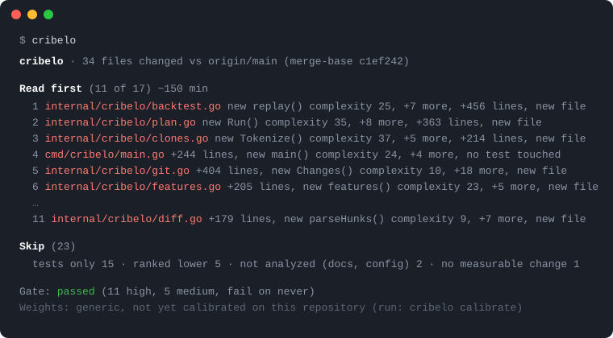

<p align="center">
  <picture>
    <source media="(prefers-color-scheme: dark)" srcset="docs/banner-dark.png">
    
  </picture>
</p>

<h3 align="center">What to read, what to skip.</h3>

<p align="center"></p>

# Cribelo

Cribelo ranks the files of a pull request by how much they need a human reader, and says why. The name is the Latin *cribellum*, a small sieve.

```
$ cribelo --base origin/main~25 --top 6
cribelo · 195 files changed vs origin/main~25 (merge-base 17f217b)

Read 6 of 195 changed files, about 4 h 21.
Start with internal/analyzer/community_aggregator.go: new findingsOf() complexity 103, +39 more, +2001/−756 lines, imported by 84 files.

                                                           complexity  lines       used by   commits 90d        clone  tests
  1  internal/analyzer/community_aggregator.go             ▮▮▮▮▮ 103   ▮▮▮▮▮ 2757  ▮▮▮▮▮ 84  ▮▮▮▮▯ 11, 2 fixes  85%    ✓
  2  internal/analyzer/aggregator.go                       ▮▮▮▮▮ 118   ▮▮▮▮▮ 639   ▮▮▮▮▮ 84  ▮▮▮▯▯ 10, 7 fixes         ✓
  3  internal/engine/php/tree_sitter_php_adapter.go        ▮▮▮▮▮ 59    ▮▮▮▮▮ 853   ▮▮▮▮▯ 19  ▮▮▮▯▯ 9, 4 fixes          ✓
  4  internal/engine/csharp/tree_sitter_csharp_adapter.go  ▮▮▮▮▯ 34    ▮▮▮▮▯ 352   ▮▮▮▯▯ 9   ▮▮▮▯▯ 8, 3 fixes   88%    ✓
  5  internal/engine/java/tree_sitter_java_adapter.go      ▮▮▮▮▯ 30    ▮▮▮▮▯ 325   ▮▮▮▯▯ 10  ▮▮▮▯▯ 7, 2 fixes   88%    ✓
  6  internal/engine/python/tree_sitter_python_adapter.go  ▮▮▮▮▯ 22    ▮▮▮▯▯ 253   ▮▮▮▯▯ 10  ▮▮▮▯▯ 6, 5 fixes   79%    ✓

Skip (189)
  tests only 85 · ranked lower 78 · not analyzed (docs, config, other languages) 13 · no measurable change 9 · deleted 2 · binary 1 · generated 1    cribelo skip

Gate: passed (60 high, 12 medium, fail on never)
Weights: generic, not yet calibrated on this repository (run: cribelo calibrate)
```

The reading list holds every file at the high level, and at least three. A small change gets three files; a change with twenty risky files gets twenty, because that is what it has. `--budget 15m` caps the list to what fits in the time you have, `--top 5` forces a count.

The ranking rests on static analysis of the code before and after the change, and on the git history of each file. On the analysis side: the cyclomatic complexity added by the functions you touched, the most complex of those functions, the afferent coupling of the file (how many files outside its own directory import it), whether a touched function is a clone of another function in the project, and whether a test was changed along with it. On the git side: how often the file was committed in the last ninety days, and how many of those commits were fixes. This is just-in-time defect prediction, the approach described by Kamei et al. in 2013, with the metrics of a real parser instead of the size of the diff alone.

Everything runs locally from the git checkout. There is no service, no account and no language model, and the same change gives the same plan on every machine.

## Install

```sh
brew install cribelo/tap/cribelo
```

Without Homebrew: `curl -fsSL https://raw.githubusercontent.com/cribelo/cribelo/main/install.sh | sh`. Or `go install github.com/cribelo/cribelo@latest`, which needs a C compiler for the tree-sitter parsers. Binaries for Linux, macOS and Windows are on the [releases page](https://github.com/cribelo/cribelo/releases). Supported languages: Go, PHP, Python, Rust, TypeScript, Java and C#.

```sh
cribelo                      # plan for the working tree against the default branch
cribelo --base origin/develop
cribelo --budget 15m         # as many files as fit in fifteen minutes
cribelo --top 5              # exactly five files
cribelo explain path/to/file # every signal behind one file
cribelo skip                 # the skipped files, with the reason
```

## In a pull request

Save this as `.github/workflows/cribelo.yml`:

```yaml
on: pull_request
permissions:
  contents: read
  pull-requests: write
jobs:
  cribelo:
    runs-on: ubuntu-latest
    steps:
      - uses: actions/checkout@v4
        with: { fetch-depth: 0 }
      - uses: cribelo/cribelo@v1
```

The plan is posted as a single comment and updated on each push. `fail-on: high` makes the job fail when a file reaches the high level.

## The signals

| Signal | Where it comes from |
|---|---|
| lines added, lines deleted | the diff |
| complexity added | cyclomatic complexity of the touched functions, after minus before |
| max complexity | the most complex function touched |
| afferent coupling | the import graph of the repository, files outside the directory only |
| fixes, churn | commits on the file in the ninety days before the change, and how many of them were fixes |
| new file, untested | the diff and the tree |
| clone | similarity of a touched function with any other function of the project, detected on normalized token fingerprints |

Each signal has a weight, the weighted sum goes through a logistic function, and the files are sorted by the result. A score of 0.70 or more is high, 0.40 or more medium; the high files are the reading list. The reasons printed in the plan are the three signals that contributed most. `cribelo explain` prints all of them:

```
$ cribelo explain internal/cribelo/git.go
internal/cribelo/git.go  score 0.80 (high), ~21 min, not in the reading list

Signals  value → weight in the decision (positive pushes up)
  lines added                                                   404  +2.10
  decision points added (new or grown functions)                 55  +2.01
  highest cyclomatic complexity among touched functions          10  +0.72
  file is new                                                     1  +0.30
  files outside its directory depending on this file              1  +0.28
  ...
```

The transforms, the default weights and the clone detection parameters are in [how it is computed](docs/how-it-is-computed.md).

## Measuring it on your own history

`cribelo backtest` replays the first-parent history of the base branch. For each past change it rebuilds the plan from the code of that time, then looks at the ninety days that followed: a file counts as fixed when a commit whose message says fix, revert, regression or the equivalent in a few languages touches it. The output is the share of those files the reading list contained, and the share of the changed lines you would have read to get there, for the top three files, for the rule the plan applies (every high file, at least three), and for reading the largest files first.

```
$ cribelo backtest
79 changes qualified, 2023-10-22 → 2026-07-28: 1007 code files, 151 of them (15%) later touched by a fix.

generic weights, all qualified changes
  Reading the top-3 files covered 40% of the files later fixed, for 59% of the changed lines.
  Reading the 3 largest files instead: 36% of the files later fixed, for 63% of the lines.
  Reading every high file, at least 3 (3.7 files a change): 44% of the files later fixed, for 71% of the lines.
```

These figures are from the AST Metrics repository. A fix commit touching a file later is a noisy label, the fix may be elsewhere, so read the result as a comparison with the naive plan rather than as a verdict.

`cribelo calibrate` fits a logistic regression on the oldest 70 % of those changes, scores it on the most recent 30 %, and writes the weights to `.cribelo/weights.json` only when they beat the defaults on that held-out part, with the top three files and with every high file. The high and medium thresholds move with the weights, so that a calibrated model flags the same share of files as the generic one. Commit the file; every plan then uses it. This is a quarterly job, not a CI step.

## Configuration

`.cribelo.yaml` at the root of the repository, all keys optional:

```yaml
base: origin/develop
top: 3                      # the least number of files to read
fail_on: never              # high, medium or never
ignore:
  - "migrations/**"
  - "*.generated.go"
fix_pattern: "JIRA-\\d+"    # commits matching this also count as fixes
```

Fix commits are recognized by `fix:` and `revert:` conventional types, the 🐛 🚑 🩹 ⏪ gitmoji, and the usual words in English, French, Spanish, Portuguese and German. `fix_pattern` adds a convention of your own, a tracker key for instance.

## Source

Cribelo is a command of [AST Metrics](https://github.com/ast-metrics/ast-metrics): the parsers, the complexity model and the dependency graph come from there, and the code of Cribelo lives in its `cribelo` and `internal/cribelo` directories. This repository pins a revision of it in `go.mod` and builds the binary from it, and holds the Action, the installer, the documentation and the issues. MIT license.
